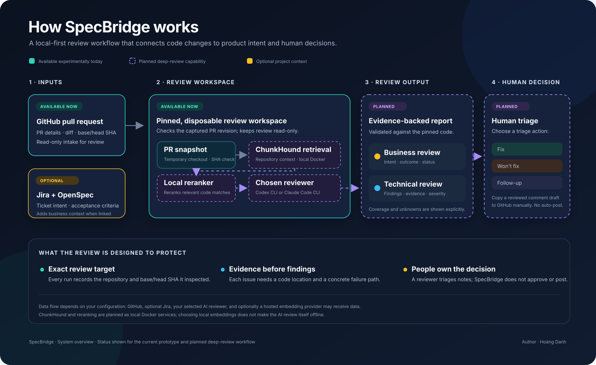

# SpecBridge

**AI can write code faster than teams can verify it.**

AI-assisted development is increasing the pace of implementation, while review still depends on limited reviewer time and context spread across code, tickets, and specs. That gap makes it harder to catch regressions, confirm that a change meets the intended user need, and distinguish a real risk from a vague suggestion.

SpecBridge is an open-source project built to make PR reviews easier to inspect and act on. Its planned deep-review workflow connects a pull request to its exact code revision, relevant repository context, and optional Jira or OpenSpec requirements. It presents separate Business and Technical reviews, with findings tied to evidence and a clear account of what was checked.

The goal is to help teams make better review decisions, not to make those decisions for them. People inspect and triage findings; SpecBridge does not automatically approve a PR or post comments. Today’s experimental prototype supports a single-pass Codex CLI review. The deeper ChunkHound, local reranking, Codex/Claude selection, and review UI workflow is still in development.

## Why use it?

- **Developers** get actionable findings with a concrete code location and failure path.
- **PMs** can see whether linked requirements are met, incomplete, unmet, or still unclear.
- **Reviewers** can inspect the evidence and coverage behind a review before deciding what to do.

## Planned deep-review flow

1. Start the local retrieval services and choose a reviewer CLI.
2. Give SpecBridge a GitHub PR URL.
3. Inspect staged, evidence-backed findings tied to the exact PR revision; decide what to do as a team.

The diagram below shows the end-to-end flow and distinguishes what is available today from what is planned. [Open the SVG](docs/system-overview.svg).

SpecBridge is designed to run inside your own environment. You control how it connects to Jira, your code, and the AI service you choose.

For the planned deep-review stack, code embeddings can run locally or use OpenRouter `baai/bge-m3`; ChunkHound and the reranker stay local in Docker. The OpenRouter option sends indexed source text to OpenRouter and its serving provider.

The proposed local default is Qwen3-Embedding-0.6B served by Ollama in Docker. Users can choose local BGE-M3 or provide another OpenAI-compatible embedding endpoint. Embeddings are separate from the local reranker. See the [embedding options](docs/embedding-options.md).

## Try it

The current prototype supports an experimental, single-pass Codex CLI review. Follow the [prototype quickstart](docs/quickstart.md). It does not yet include the required ChunkHound/reranker stack, Claude selection, staged analysis, or review UI, so it is not the complete deep-review workflow described above. The [AI setup prompt](docs/AI-SETUP-PROMPT.md) is the onboarding prompt planned for the completed local stack.

## Sample review

You can review SpecBridge sample outputs in [English](docs/examples/sample-review.md) and [Vietnamese](docs/examples/sample-review-vi.md). Both reports use a fictional repository and findings; no real project review is included.

## Project status

SpecBridge is an early open-source project. PR intake, a one-pass Codex CLI prototype, and Jira/OpenSpec context generation are available experimentally. Local Docker code retrieval, local reranking, selectable Codex/Claude adapters, resumable deep review, and the review UI remain in development.

## Get involved

If SpecBridge looks useful, please star or fork the repo. If you find a bug or hit a setup issue, raise it in [GitHub Issues](https://github.com/Bug03/specbridge/issues) so we can investigate and fix it together.

We welcome feedback from developers, product managers, and maintainers. Start with the [product overview](docs/product-brief.md), see the [roadmap](docs/roadmap.md), or help shape the work in GitHub Issues.

The [review method](docs/review-method.md) describes how findings stay grounded and review output remains under human control. See the [setup experience](docs/setup-experience.md) for the one-command onboarding design and the [AI setup prompt](docs/AI-SETUP-PROMPT.md). Technical details are in the [implementation plan](docs/implementation-plan.md).

## License

MIT. See [LICENSE](LICENSE).
