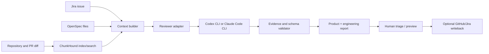

# Implementation plan

## Product outcome

SpecBridge gives a self-hosted team a traceable path from **Jira intent → OpenSpec requirements → codebase context → Codex/Claude review → PR closure**.

The first release should prove the chain with one repository, one Jira project, one GitHub repository, and one reviewer provider. Keep adapters provider-neutral so a second provider can be added without changing findings or report formats.

### Recommended first-stack defaults

- **Deployment:** Docker Compose, single team, customer-managed persistent storage.
- **Ticket tracker:** Jira Cloud, read-only for the first release.
- **Specs:** OpenSpec Markdown tracked in the target repository.
- **Code context:** ChunkHound MCP over stdio inside the review worker; exact search first, semantic/deep research when configured and needed.
- **Reviewer order:** build the Codex CLI adapter first for the initial end-to-end slice, then Claude Code CLI. Keep the provider contract neutral so a team can choose either at runtime.
- **Review target:** GitHub PR after Jira-to-spec context export works.

These are sequencing choices for an initial implementation, not requirements that every self-hosted team use those products.

## Proposed architecture



**SpecBridge owns:** source connectors, explicit issue-to-spec links, immutable run metadata, context assembly, review orchestration, normalized findings, evidence validation, permissions, and report rendering.

**ChunkHound owns:** repository indexing and code search/research. Start with its MCP `search` capability behind an adapter; add `code_research` as an opt-in for cross-file questions when configured. Use `search` for targeted retrieval and verify citations independently in SpecBridge.

**Codex/Claude own:** reasoning over the provided task and retrieved evidence. Each runs through a separate adapter and emits the same versioned finding schema. They should not modify the PR in review mode.

**OpenSpec owns:** accepted, versioned requirements and scenarios. **Jira owns:** issue workflow, assignee, and execution tracking. SpecBridge links them; it should not silently become a competing source of truth.

## Milestones and completion gates

### M0 — Lock the first slice

**Decisions:** Jira Cloud first; GitHub first; OpenSpec Markdown in a repository; self-hosted Docker deployment; ChunkHound for codebase context; Codex CLI or Claude Code CLI as the first reviewer.

**Deliverables:** reviewed OpenSpec changes, architecture diagram, threat/data-flow notes, sample input/output fixture.

**Done when:** the project can explain which system owns each fact, what leaves the self-hosted environment, and how the first report will be judged.

### M1 — Self-hosted foundation

**Build:** application service, persistent state, configuration validation, health/readiness endpoint, container/development setup, upgrade and backup notes. Do not build multi-tenancy or a hosted control plane yet.

**Security/data rules:** secrets are injected through operator-managed configuration; logs redact credentials and sensitive ticket content; no telemetry by default; outbound services are listed; model egress is opt-in and visible. Support local/private model endpoints where the chosen adapter allows them.

**Done when:** a contributor can start the app in a clean local environment from the guide, see readiness diagnostics, stop it, restart it without losing configured state, and understand all required outbound connections.

### M2 — Jira and OpenSpec context

**Build order:** (1) parse OpenSpec files and stable references, (2) fetch one Jira issue read-only, (3) manually link issue → spec/scenario, (4) detect stale/missing links, (5) render Markdown and JSON context bundle.

**Context bundle includes:** issue key/title/status/description/acceptance criteria; linked spec identifiers and exact source revision; project rules; unresolved questions; provenance for every item. Do not include Jira comments or attachments by default; add them only behind explicit scope controls.

**Done when:** a user can request context for a Jira issue, review every included source/revision, export it for an agent, and receive clear errors for unavailable or stale sources.

### M3 — ChunkHound integration

**Build:** a `CodeContextProvider` interface with a ChunkHound adapter. Configure index root, exclusions, index state, and provider requirements. Retrieve relevant files/symbols using MCP. Add citation checks against the pinned checkout SHA.

**Operational choice:** run ChunkHound as a local stdio MCP process first when SpecBridge and the repository share a host/container. Consider authenticated Streamable HTTP only when deployment topology requires it. Bind internal services to a private network and require authentication for non-loopback endpoints.

**Model/cost choice:** do not invoke ChunkHound's LLM-backed deep research for every review by default. Use deterministic/exact search first, then semantic retrieval, then optional cross-file research. The reviewer adapter handles the main review synthesis. This avoids paying for two full analysis passes on every PR.

**Done when:** an agent review can request relevant code context, every returned code citation resolves in the indexed revision, excluded files stay excluded, and the system reports when semantic search is unavailable rather than pretending it ran.

### M4 — Reviewer adapters (Codex and Claude)

Define one internal contract:

```text
ReviewRequest
  run_id, repo_path, base_sha, head_sha
  jira_issue, linked_requirements, diff_summary
  retrieved_context, review_policy, output_schema_version

ReviewResult
  provider, model, session_id, usage, exit_status
  findings[], checked_areas[], unknowns[], warnings[]
```

**Adapter sequence:** implement the first provider end to end, retain the raw provider output securely for diagnostics, parse into the common schema, validate schema and citations, then add the second provider. Provider choice is explicit per run; later, teams can set a default.

**Codex path:** invoke Codex CLI in non-interactive execution mode and consume structured JSON/JSONL or schema-constrained output. Pin the sandbox and approval configuration for review runs; read-only review must not inherit a setting that allows file edits just because another workflow needs them.

**Claude path:** invoke Claude Code print mode with structured output and explicit tool/permission restrictions. Do not enable permission bypass flags. Restrict tools to the minimum required for reading diff/context; no Edit/Write tools in review mode.

**Done when:** the same fixture produces a valid normalized report from either adapter; process failures/timeouts are visible; no provider can post GitHub comments or edit files through the review adapter.

### M5 — PR intent review

**Build:** load PR metadata, exact base/head SHAs and diff; map changed areas to linked requirements; retrieve affected call sites/context with ChunkHound; ask the reviewer for product conformance and engineering findings separately; validate evidence and origin against the base diff.

**Report sections:** executive summary; PM intent/acceptance coverage; Dev correctness/security/testing/maintainability; evidence and confidence; checked/not-checked coverage; questions; provider/model/revision provenance.

**Done when:** report is pinned to a SHA; findings include a concrete failure mode plus verifiable path/line; pre-existing vs introduced is explicit or uncertain; a reviewer can reproduce why the finding appeared.

### M6 — Re-review and controlled writeback

**Build:** compare new head against prior run; keep history; classify findings as resolved, still present, regressed, new, or unable to verify. Add draft-only Jira/OpenSpec updates and GitHub review preview.

**Done when:** no external write occurs without an explicit user action; writeback is idempotent where possible, attributable, and auditable; old run remains tied to its original SHA.

### M7 — Release and public onboarding

**Build:** one-command self-host guide, environment example without secrets, backup/restore guide, sample repo/demo ticket/report, troubleshooting, security/data-flow page, and landing page.

**Done when:** a new contributor can deploy, connect a test Jira project, create a spec link, export context, and run one review without relying on an undocumented maintainer step.

## Review quality loop

Before broad release, create a small evaluation set with expected findings and counterexamples: real bug, pre-existing issue, wrong citation, spec mismatch, ambiguous ticket, generated file noise, large diff, prompt injection in issue text, and code outside the diff that explains impact. Track confirmed findings, false positives, missed seeded issues, citation accuracy, coverage honesty, latency, and cost. Do not optimize for raw finding count.

## First implementation order

1. Write/agree on the M1 and M2 OpenSpec changes.
2. Define config, run/finding schemas, and context provenance.
3. Implement OpenSpec parser and fixture-backed Markdown/JSON output.
4. Add Jira read-only connector and issue-to-spec linking.
5. Add self-hosted deployment and secrets/redaction boundary.
6. Add ChunkHound search adapter and citation verification.
7. Add one reviewer adapter, then the second.
8. Add GitHub PR review and re-review loop.

This order keeps the product useful before agent orchestration, and gives each later review an auditable intent/context foundation.
