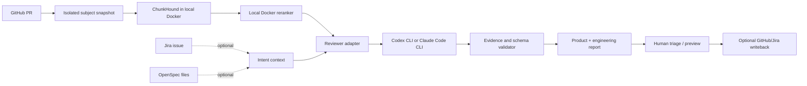

# Implementation plan

## Product outcome

SpecBridge gives a team a traceable path from **GitHub PR → local code retrieval and reranking → provider-selected deep review → evidence-backed findings → optional Jira/OpenSpec intent → human triage**.

The complete review flow requires ChunkHound and a reranker model running in local Docker containers. Jira and OpenSpec add product intent but remain optional for code review. The operator chooses Codex CLI or Claude Code CLI. A run cannot be marked complete if required code-context stages did not run.

### Recommended first-stack defaults

- **Deployment:** Docker Compose, single team, customer-managed persistent storage.
- **Ticket tracker:** Jira Cloud, optional read-only context.
- **Specs:** OpenSpec Markdown tracked in the target repository.
- **Code context:** ChunkHound, an optional local Ollama embedding service, and a TEI-compatible reranker run as local Docker services. Recommend `qwen3-embedding:0.6b` locally; also offer BGE-M3, a user-supplied OpenAI-compatible endpoint, or OpenRouter `baai/bge-m3`. The reranker remains a separate local service in every mode. Use ChunkHound MCP behind an adapter and verify all citations against the pinned checkout. Make network egress visible. See [embedding options](embedding-options.md).
- **Reviewer selection:** support Codex CLI and Claude Code CLI through separate adapters. Let the user choose either from configuration or for each run; neither provider is hard-coded as the product default.
- **Setup:** one guided `.env` and Docker Compose path, with a preflight that checks Docker, model download/storage, GitHub CLI access, the selected reviewer CLI, ChunkHound, and reranker health before cloning a PR.
- **Review target:** GitHub PR is the primary input from the first runnable slice.

These are sequencing choices for an initial implementation, not requirements that every self-hosted team use those products.

## Proposed architecture



**SpecBridge owns:** PR intake, immutable subject metadata, optional source connectors and issue-to-spec links, context assembly, review orchestration, normalized findings, evidence validation, permissions, and report rendering.

**ChunkHound owns:** repository indexing and code search/research in the required local Docker stack. Start with its MCP `search` capability behind an adapter; add deeper research only when configured. The local reranker refines retrieved candidates. SpecBridge verifies every cited location against the pinned subject tree. If either required service is unavailable, the run is blocked or incomplete and cannot be silently downgraded.

**Codex/Claude own:** reasoning over the PR, optional intent, and retrieved evidence. Each runs through a separate adapter and emits the same versioned finding schema. They should not modify the PR in review mode.

**OpenSpec owns:** accepted, versioned requirements and scenarios. **Jira owns:** issue workflow, assignee, and execution tracking. SpecBridge links them; it should not silently become a competing source of truth.

## Milestones and completion gates

### M0 — Lock the first slice

**Decisions:** GitHub PR first; local isolated checkout; ChunkHound and reranker are required local Docker services; Codex CLI and Claude Code CLI are user-selectable; Jira Cloud and OpenSpec are optional intent context; self-hosting before any hosted control plane.

**Deliverables:** reviewed OpenSpec changes, architecture diagram, threat/data-flow notes, sample input/output fixture.

**Done when:** the project can explain which system owns each fact, what leaves the self-hosted environment, and how the first report will be judged.

### M1 — Local review stack and preflight

**Build:** one guided `specbridge setup` command with a maintained Docker image for ChunkHound, an optional Ollama embedding service, and a Docker Compose reranker service; use persistent model/index storage and health checks. Generate ChunkHound/MCP configuration internally. Offer Qwen3-Embedding-0.6B, local BGE-M3, a user-supplied OpenAI-compatible endpoint, or OpenRouter `baai/bge-m3`. Only hosted embedding requires a vendor API key. Preflight Docker, selected CLI, GitHub identity/access, services, and configured embedding endpoint before review work begins. Select compatible images for x86_64 or ARM64; on Apple Silicon, Docker inference is CPU-only. See [setup experience](setup-experience.md).

**Done when:** a new operator can start both local services, see actionable readiness checks, and select either supported reviewer without editing source code. A failed required service prevents a run from being reported as complete.

### M2 — PR intake and provider adapters

**Build:** accept a GitHub PR URL; check repository access and PR identity; capture base/head SHAs; fetch the PR into a disposable checkout; run the selected Codex or Claude CLI reviewer read-only; retrieve code context with ChunkHound and rerank locally; produce a local report with evidence and coverage limits. Do not post comments or approvals. Abort if the checked-out head differs from the captured head.

**Done when:** a reviewer can run one command against a PR, see which exact head was reviewed, inspect findings tied to changed code, and retain the local repository unchanged.

### M3 — Jira and OpenSpec context

**Build order:** (1) parse OpenSpec files and stable references, (2) fetch one Jira issue read-only, (3) manually link issue → spec/scenario, (4) detect stale/missing links, (5) render Markdown and JSON context bundle.

**Context bundle includes:** issue key/title/status/description/acceptance criteria; linked spec identifiers and exact source revision; project rules; unresolved questions; provenance for every item. Do not include Jira comments or attachments by default; add them only behind explicit scope controls.

**Done when:** a user can request context for a Jira issue, review every included source/revision, export it for an agent, and receive clear errors for unavailable or stale sources.

### M4 — Deeper, resumable review pipeline

**Build:** split review into discovery, focused analysis, independent evidence validation, and synthesis. Feed reranked context to the selected reviewer. Persist stage outputs and findings so a run can resume after a provider or usage limit. Compare a new head against prior runs; classify findings as resolved, still present, regressed, new, or unverified. Show checked, partial, skipped, and failed work explicitly.

**Done when:** a re-review is pinned to the new SHA and every previous finding receives an evidence-backed status; no partial run is labeled final; no external write occurs without a user action.

### M5 — Review history and UI

Define one internal contract:

```text
ReviewRequest
  run_id, repo_path, base_sha, head_sha
  jira_issue, linked_requirements, diff_summary
  retrieved_context, review_policy, output_schema_version

ReviewResult
  provider, model, session_id, usage, exit_status
  findings[], checked_areas[], unknowns[], warnings[]
```

**Adapters:** each provider returns the same normalized schema. Keep the provider choice explicit per run or in the user's `.env`; retain raw output securely for diagnostics, parse into the common schema, and validate schema and citations.

**Codex path:** invoke Codex CLI in non-interactive execution mode and consume structured JSON/JSONL or schema-constrained output. Pin the sandbox and approval configuration for review runs; read-only review must not inherit a setting that allows file edits just because another workflow needs them.

**Claude path:** invoke Claude Code print mode with structured output and explicit tool/permission restrictions. Do not enable permission bypass flags. Restrict tools to the minimum required for reading diff/context; no Edit/Write tools in review mode.

**Done when:** the same fixture produces a valid normalized report from either adapter; process failures/timeouts are visible; no provider can post GitHub comments or edit files through the review adapter.

### M6 — Review workspace UI

**Build:** provide a run overview with stage progress and a final summary; let a reviewer inspect, accept, dismiss, or follow up each finding with its evidence; assemble a copyable GitHub review comment from selected findings after the run is complete.

**Safety boundary:** the initial UI copies a human-reviewed draft. It never posts, approves, or submits a comment to GitHub automatically. Incomplete reviews remain labeled partial and include coverage limits.

**Done when:** a reviewer can follow the run, inspect each finding against the pinned SHA, choose what belongs in the final report, and copy a comment only after reviewing the full draft.

### M7 — Release and public onboarding

**Build:** local/self-host quickstart, environment example without secrets, backup/restore guide, sample repo/demo report, troubleshooting, security/data-flow page, and landing page.

**Done when:** a new contributor can deploy, connect a test Jira project, create a spec link, export context, and run one review without relying on an undocumented maintainer step.

## Review quality loop

Before broad release, create a small evaluation set with expected findings and counterexamples: real bug, pre-existing issue, wrong citation, spec mismatch, ambiguous ticket, generated file noise, large diff, prompt injection in issue text, and code outside the diff that explains impact. Track confirmed findings, false positives, missed seeded issues, citation accuracy, coverage honesty, latency, and cost. Do not optimize for raw finding count.

## First implementation order

1. Add a maintained ChunkHound container and Docker Compose reranker service, persistent storage, health checks, and `.env`-based configuration.
2. Add preflight for Docker, GitHub access, the chosen reviewer CLI, embeddings, ChunkHound, and reranker.
3. Capture GitHub PR metadata and immutable base/head identity; index the pinned checkout and retrieve/rerank context locally.
4. Add user-selectable read-only Codex and Claude adapters with a normalized finding schema and evidence/origin checks.
5. Add discovery, focused analysis, independent validation, resumability, then Jira/OpenSpec context.
6. Build the progress and triage UI, copy-only comment composer, and evaluation fixtures.
7. Validate the AI setup prompt against the actual shipped commands, then publish self-hosting docs and the landing page.

This order makes the required local retrieval stack explicit while keeping Jira/OpenSpec as optional intent enrichment. The existing Codex-only CLI is an experimental prototype and does not yet meet the complete-review contract above.
