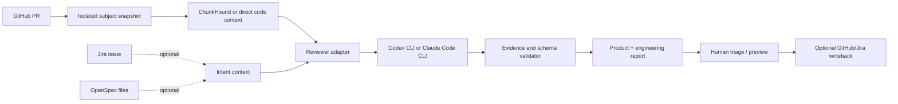

# Implementation plan

## Product outcome

SpecBridge gives a team a traceable path from **GitHub PR → isolated review → evidence-backed findings → optional Jira/OpenSpec intent → human triage**.

The first release should make a PR review useful before asking a team to connect Jira, OpenSpec, or a code-indexing service. Add those as optional evidence sources behind the core review flow. Keep reviewer adapters provider-neutral so a second provider can be added without changing findings or report formats.

### Recommended first-stack defaults

- **Deployment:** Docker Compose, single team, customer-managed persistent storage.
- **Ticket tracker:** Jira Cloud, optional read-only context.
- **Specs:** OpenSpec Markdown tracked in the target repository.
- **Code context:** ChunkHound MCP over stdio inside the review worker; exact search first, semantic/deep research when configured and needed.
- **Reviewer order:** build the Codex CLI adapter first for the initial end-to-end slice, then Claude Code CLI. Keep the provider contract neutral so a team can choose either at runtime.
- **Review target:** GitHub PR is the primary input from the first runnable slice.

These are sequencing choices for an initial implementation, not requirements that every self-hosted team use those products.

## Proposed architecture



**SpecBridge owns:** PR intake, immutable subject metadata, optional source connectors and issue-to-spec links, context assembly, review orchestration, normalized findings, evidence validation, permissions, and report rendering.

**ChunkHound owns:** optional repository indexing and code search/research. Start with its MCP `search` capability behind an adapter; add `code_research` when configured. It accelerates discovery; SpecBridge verifies every cited location against the pinned subject tree. Direct Git/rg inspection remains an explicit fallback.

**Codex/Claude own:** reasoning over the PR, optional intent, and retrieved evidence. Each runs through a separate adapter and emits the same versioned finding schema. They should not modify the PR in review mode.

**OpenSpec owns:** accepted, versioned requirements and scenarios. **Jira owns:** issue workflow, assignee, and execution tracking. SpecBridge links them; it should not silently become a competing source of truth.

## Milestones and completion gates

### M0 — Lock the first slice

**Decisions:** GitHub PR first; local isolated checkout; Codex CLI first; Jira Cloud and OpenSpec as optional intent context; ChunkHound as an optional research accelerator; self-hosting before any hosted control plane.

**Deliverables:** reviewed OpenSpec changes, architecture diagram, threat/data-flow notes, sample input/output fixture.

**Done when:** the project can explain which system owns each fact, what leaves the self-hosted environment, and how the first report will be judged.

### M1 — PR intake and first reviewer

**Build:** accept a GitHub PR URL; check repository access and PR identity; capture base/head SHAs; fetch the PR into a disposable checkout; run a read-only Codex review; produce a local report with evidence and coverage limits. Do not post comments or approvals. Abort if the checked-out head differs from the captured head.

**Done when:** a reviewer can run one command against a PR, see which exact head was reviewed, inspect findings tied to changed code, and retain the local repository unchanged.

### M2 — Jira and OpenSpec context

**Build order:** (1) parse OpenSpec files and stable references, (2) fetch one Jira issue read-only, (3) manually link issue → spec/scenario, (4) detect stale/missing links, (5) render Markdown and JSON context bundle.

**Context bundle includes:** issue key/title/status/description/acceptance criteria; linked spec identifiers and exact source revision; project rules; unresolved questions; provenance for every item. Do not include Jira comments or attachments by default; add them only behind explicit scope controls.

**Done when:** a user can request context for a Jira issue, review every included source/revision, export it for an agent, and receive clear errors for unavailable or stale sources.

### M3 — ChunkHound integration

**Build:** a `CodeContextProvider` interface with a ChunkHound adapter. Configure index root, exclusions, index state, and provider requirements. Retrieve relevant files/symbols using MCP. Add citation checks against the pinned checkout SHA.

**Operational choice:** run ChunkHound as a local stdio MCP process first when SpecBridge and the repository share a host/container. Consider authenticated Streamable HTTP only when deployment topology requires it. Bind internal services to a private network and require authentication for non-loopback endpoints.

**Model/cost choice:** do not invoke ChunkHound's LLM-backed deep research for every review by default. Use deterministic/exact search first, then semantic retrieval, then optional cross-file research. The reviewer adapter handles the main review synthesis. This avoids paying for two full analysis passes on every PR.

**Done when:** an agent review can request relevant code context, every returned code citation resolves in the indexed revision, excluded files stay excluded, and the system reports when semantic search is unavailable rather than pretending it ran.

### M4 — Second reviewer adapter

Define one internal contract:

```text
ReviewRequest
  run_id, repo_path, base_sha, head_sha
  jira_issue, linked_requirements, diff_summary
  retrieved_context, review_policy, output_schema_version

ReviewResult
  provider, model, session_id, usage, exit_status
  findings[], checked_areas[], unknowns[], warnings[]
```

**Adapter sequence:** implement the first provider end to end, retain the raw provider output securely for diagnostics, parse into the common schema, validate schema and citations, then add the second provider. Provider choice is explicit per run; later, teams can set a default.

**Codex path:** invoke Codex CLI in non-interactive execution mode and consume structured JSON/JSONL or schema-constrained output. Pin the sandbox and approval configuration for review runs; read-only review must not inherit a setting that allows file edits just because another workflow needs them.

**Claude path:** invoke Claude Code print mode with structured output and explicit tool/permission restrictions. Do not enable permission bypass flags. Restrict tools to the minimum required for reading diff/context; no Edit/Write tools in review mode.

**Done when:** the same fixture produces a valid normalized report from either adapter; process failures/timeouts are visible; no provider can post GitHub comments or edit files through the review adapter.

### M5 — Re-review and controlled writeback

**Build:** compare a new head against prior runs; keep review history; classify findings as resolved, still present, regressed, new, or unverified. Keep any eventual GitHub/Jira writeback as a draft for explicit review.

**Done when:** a re-review is pinned to the new SHA and every previous finding receives an evidence-backed status; no external write occurs without a user action.

### M6 — Release and public onboarding

**Build:** local/self-host quickstart, environment example without secrets, backup/restore guide, sample repo/demo report, troubleshooting, security/data-flow page, and landing page.

**Done when:** a new contributor can deploy, connect a test Jira project, create a spec link, export context, and run one review without relying on an undocumented maintainer step.

## Review quality loop

Before broad release, create a small evaluation set with expected findings and counterexamples: real bug, pre-existing issue, wrong citation, spec mismatch, ambiguous ticket, generated file noise, large diff, prompt injection in issue text, and code outside the diff that explains impact. Track confirmed findings, false positives, missed seeded issues, citation accuracy, coverage honesty, latency, and cost. Do not optimize for raw finding count.

## First implementation order

1. Capture GitHub PR metadata and immutable base/head identity.
2. Fetch a disposable subject checkout and run a read-only Codex review.
3. Define finding schema, evidence and origin checks, and review history.
4. Enrich a PR review with linked Jira/OpenSpec context when available.
5. Add ChunkHound search as a verified discovery accelerator.
6. Add Claude as a second reviewer adapter.
7. Add human-gated review comments, re-review, and self-hosted deployment.

This order makes PR review useful on its own, while keeping product intent and repository search available as explicit enrichment.
